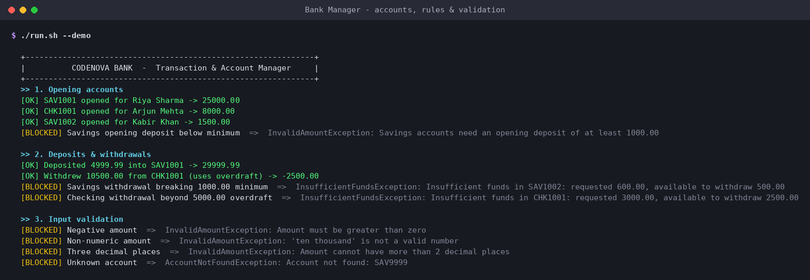
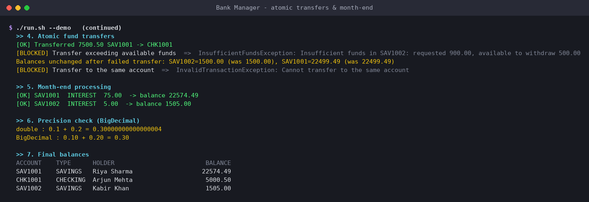
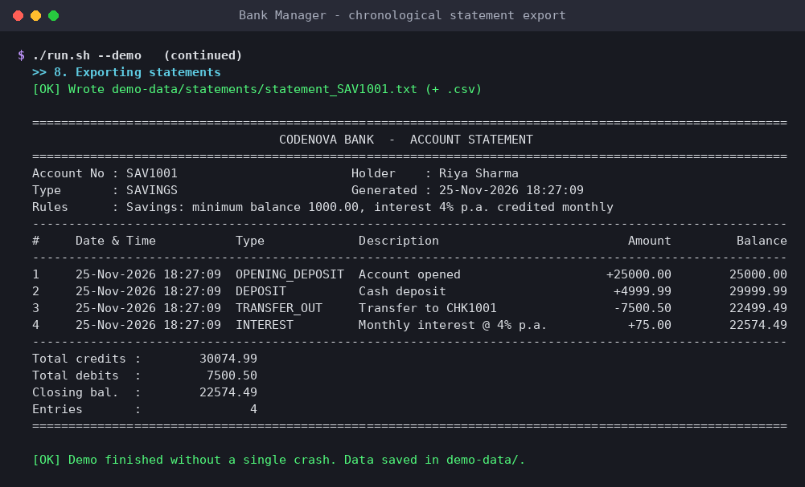
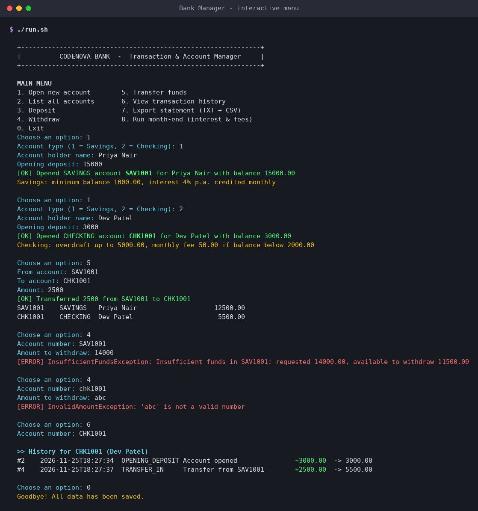
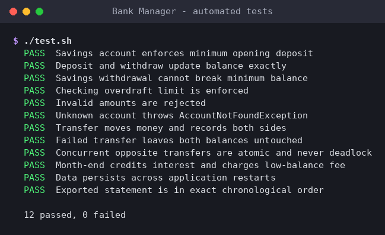
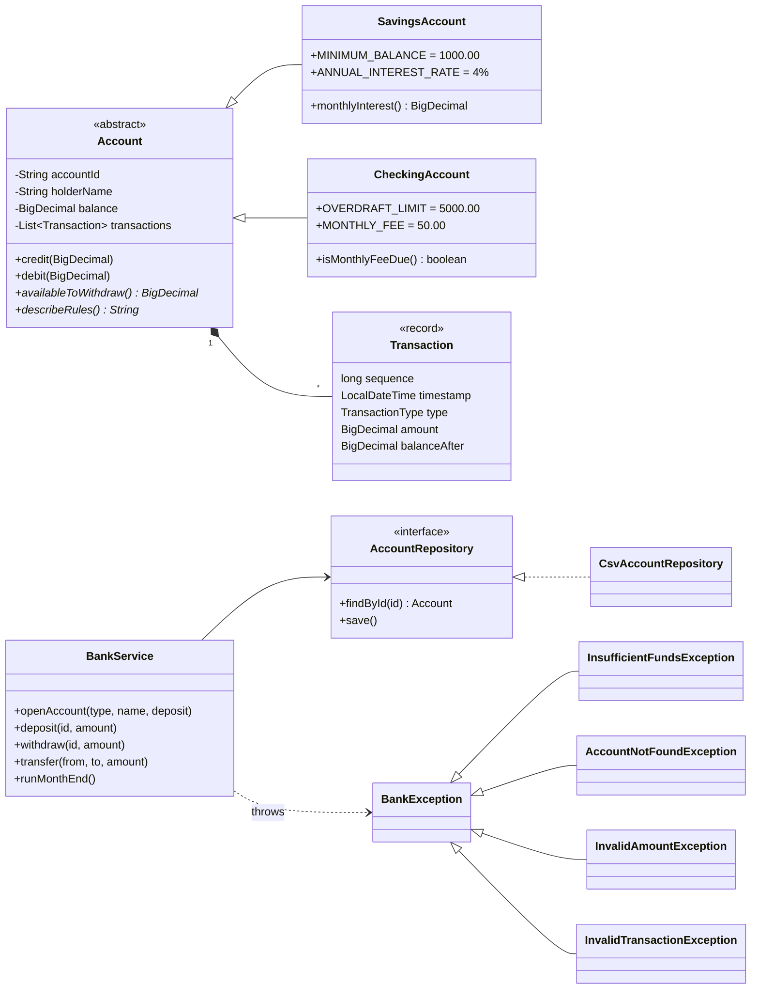

# 🏦 Bank Transaction & Account Manager

> An object-oriented banking application in pure Java that handles savings and checking accounts, deposits, withdrawals, **atomic fund transfers** and chronological statement exports. Every rule violation surfaces as a **custom exception**, and the app never crashes.


**CodeNova Internship · Batch 02 · Java Programming · Task 2: Encapsulation & Exception Handling**

---

## ✨ Features

| Feature | Details |
|---|---|
| **Two account types** | `SavingsAccount` (4% p.a. interest, ₹1,000 minimum balance) and `CheckingAccount` (₹5,000 overdraft, ₹50 low-balance fee) |
| **Deposit / Withdraw / Transfer** | Every operation is validated before any balance changes |
| **Atomic transfers** | Ordered locking plus rollback: money is never created or lost, even under 400 concurrent transfers |
| **Custom exceptions** | `InsufficientFundsException`, `AccountNotFoundException`, `InvalidAmountException`, `InvalidTransactionException`, all extending `BankException` |
| **Exact money math** | `BigDecimal` with scale 2 and banker's rounding (`HALF_EVEN`), never `double` |
| **Statement export** | A formatted `.txt` statement and a machine-readable `.csv`, both in exact chronological order |
| **Month-end processing** | Credits interest and charges maintenance fees in one step |
| **Persistence** | Accounts and the full ledger survive restarts (atomic CSV writes) |
| **Interactive menu + demo mode** | `./run.sh` for the menu, `./run.sh --demo` for a scripted tour of every feature |

---

## 📸 Screenshots

**Account rules and input validation:** every bad action is blocked with a specific exception.


**Atomic transfers, month-end interest and BigDecimal precision**


**Exported statement (chronological, with totals)**


**Interactive menu:** wrong inputs show an error and return to the menu.


**Automated test suite**


---

## 🛠 Tech Stack

- **Java 17+** (records, switch expressions, pattern-matching `instanceof`)
- **BigDecimal** for all currency values
- **Java Collections**: `LinkedHashMap` (account store), `ArrayList` (ledger)
- **java.util.concurrent**: `ReentrantLock`, `AtomicLong` (thread-safe transfers and sequence numbers)
- **java.time**: `LocalDateTime`, `Clock`
- **NIO.2 Files API** for atomic CSV persistence
- **No external libraries.** Only a JDK is needed.

---

## 📁 Project Structure

```
bank-transaction-manager/
├── src/main/java/com/codenova/bank/
│   ├── Main.java                      # Entry point (menu or --demo)
│   ├── model/                         # Domain entities
│   │   ├── Account.java               # Abstract base: encapsulated balance + ledger
│   │   ├── SavingsAccount.java        # Interest + minimum balance rule
│   │   ├── CheckingAccount.java       # Overdraft + maintenance fee rule
│   │   ├── Transaction.java           # Immutable ledger entry (record)
│   │   ├── TransactionType.java
│   │   └── AccountType.java
│   ├── exception/                     # Custom business exceptions
│   │   ├── BankException.java         # Base checked exception
│   │   ├── InsufficientFundsException.java
│   │   ├── AccountNotFoundException.java
│   │   ├── InvalidAmountException.java
│   │   └── InvalidTransactionException.java
│   ├── repository/                    # Persistence layer
│   │   ├── AccountRepository.java     # Interface
│   │   ├── CsvAccountRepository.java  # CSV implementation (atomic writes)
│   │   └── CsvUtil.java
│   ├── service/                       # Business logic / controllers
│   │   ├── BankService.java           # Deposit, withdraw, transfer, month-end
│   │   ├── AmountParser.java          # Safe text -> BigDecimal conversion
│   │   └── StatementExporter.java     # TXT + CSV statements
│   └── ui/                            # Presentation
│       ├── BankConsoleApp.java        # Interactive menu
│       ├── DemoRunner.java            # Scripted walkthrough
│       └── ConsoleUi.java             # Colours & formatting
├── src/test/java/com/codenova/bank/
│   └── BankServiceTest.java           # 12 automated tests (no JUnit needed)
├── samples/                           # Sample exported statement + data files
├── screenshots/
├── pom.xml                        # Lets IntelliJ / Maven recognise the project (no dependencies)
├── .run/                          # Ready-made IntelliJ run configurations
├── run.sh / run.bat                   # Build & run
└── test.sh / test.bat                 # Build & test
```

The layers depend in one direction only, **ui → service → repository → model**, so domain entities know nothing about files or the console.

---

## 🧩 Class Diagram



**OOP concepts demonstrated**
- **Encapsulation:** `balance` is private and has no setter. It can only change through `credit()`/`debit()`, which validate and are always recorded in the ledger.
- **Inheritance & polymorphism:** `BankService` calls `account.debit()` without knowing the type. Each subclass decides its own limit through `availableToWithdraw()`.
- **Abstraction:** the service depends on the `AccountRepository` interface, not on CSV.

---

## 📏 Transaction Validation Rules

| Rule | Exception thrown |
|---|---|
| Amount must be > 0 | `InvalidAmountException` |
| Amount must be numeric (`"abc"` is rejected; `"1,250.50"` is accepted) | `InvalidAmountException` |
| At most 2 decimal places (`10.505` is rejected) | `InvalidAmountException` |
| Single transaction ≤ ₹1,00,00,000 | `InvalidAmountException` |
| Savings opening deposit ≥ ₹1,000 | `InvalidAmountException` |
| Savings balance can never drop below ₹1,000 | `InsufficientFundsException` |
| Checking balance can never drop below −₹5,000 (overdraft) | `InsufficientFundsException` |
| Account number must exist (case-insensitive) | `AccountNotFoundException` |
| Cannot transfer to the same account | `InvalidTransactionException` |
| Holder name required | `InvalidTransactionException` |

**Month-end:** savings accounts earn `balance × 4% ÷ 12`, rounded to paise. Checking accounts below ₹2,000 pay a ₹50 fee. The fee is skipped, not forced, if the account is already at its overdraft limit.

---

## ⚛️ How an Atomic Transfer Works

```
transfer(SAV1001 → CHK1001, 7500.50)
  1. Validate amount                         → fails? nothing changed
  2. Look up both accounts                   → fails? nothing changed
  3. Lock both accounts in alphabetical order (prevents deadlock when A→B and B→A run together)
  4. Debit sender (rules checked)            → fails? nothing changed
  5. Credit receiver                         → fails? sender debit is rolled back
  6. Record TRANSFER_OUT + TRANSFER_IN ledger entries, persist
  7. Unlock
```

The test *"Concurrent opposite transfers are atomic and never deadlock"* runs 400 simultaneous transfers on 8 threads and checks that the total money in the system is unchanged.

---

## 🚀 Setup & Run

**Prerequisite:** JDK 17 or newer (`java -version`). Free downloads: [Adoptium Temurin](https://adoptium.net/).

```bash
git clone https://github.com/<your-username>/bank-transaction-manager.git
cd bank-transaction-manager

# Linux / macOS / Git Bash
./run.sh            # interactive menu
./run.sh --demo     # scripted tour of every feature
./test.sh           # run the test suite

# Windows (Command Prompt / PowerShell)
run.bat
run.bat --demo
test.bat
```

**Manual build commands** (these are what the scripts run):
```bash
javac --release 17 -d out -sourcepath src/main/java src/main/java/com/codenova/bank/Main.java
java -cp out com.codenova.bank.Main
```

**IntelliJ IDEA (recommended):** choose *File → Open*, select this folder, and click **Trust Project**. IntelliJ reads `pom.xml` and sets everything up. Then pick a ready-made run configuration from the dropdown at the top right and press ▶:
- `1 - Bank App`: interactive menu
- `2 - Bank Demo`: scripted tour of every feature
- `3 - Bank Tests`: automated test suite

Runtime data is written to `data/` (menu) or `demo-data/` (demo). Both folders are git-ignored.

---

## 🧪 Test Run Documentation

The test suite uses a tiny built-in runner, so **no JUnit download is needed**. Run with `./test.sh`:

| # | Test | Verifies |
|---|---|---|
| 1 | Savings account enforces minimum opening deposit | 999.99 rejected, 1000 accepted |
| 2 | Deposit and withdraw update balance exactly | 100.10 + 0.20 − 0.10 = **100.20** exactly |
| 3 | Savings withdrawal cannot break minimum balance | Stops at exactly 1000.00 |
| 4 | Checking overdraft limit is enforced | Reaches −5000.00, then rejects 0.01 more |
| 5 | Invalid amounts are rejected | Negative, zero, text, empty, 3 decimals |
| 6 | Unknown account throws `AccountNotFoundException` | |
| 7 | Transfer moves money and records both sides | Balances, ledger types, references |
| 8 | Failed transfer leaves both balances untouched | No partial update, no ledger entries |
| 9 | Concurrent opposite transfers are atomic and never deadlock | 400 transfers on 8 threads; total conserved |
| 10 | Month-end credits interest and charges low-balance fee | 12000 → 12040.00; 500 → 450.00 |
| 11 | Data persists across application restarts | Names with commas/quotes, balances, ledger, sequence |
| 12 | Exported statement is in exact chronological order | Strictly increasing sequence numbers |

**Result: 12 passed, 0 failed** (see screenshot above).

---

## 📄 Sample Files

| File | Description |
|---|---|
| [`samples/statement_SAV1001.txt`](samples/statement_SAV1001.txt) | Formatted account statement with totals |
| [`samples/statement_SAV1001.csv`](samples/statement_SAV1001.csv) | Same statement as CSV (opens in Excel) |
| [`samples/sample_accounts.csv`](samples/sample_accounts.csv) | Persisted account data |
| [`samples/sample_transactions.csv`](samples/sample_transactions.csv) | Persisted global ledger |

---

## 💡 Design Decisions

- **Why `BigDecimal`?** `0.1 + 0.2` in `double` gives `0.30000000000000004`. Money must be exact. The demo prints both results side by side.
- **Why a global sequence number?** Several transactions can share the same second. The sequence guarantees exact chronological order in statements.
- **Why atomic file writes?** Data is written to a `.tmp` file and then moved into place, so a crash mid-save never corrupts the data.
- **Why checked exceptions?** The compiler forces every caller to handle business failures, so the UI can't forget to catch one.

---

## 👤 Author

**Vishrutha R** · CodeNova Internship Batch 02 (Java Programming)
[LinkedIn](https://www.linkedin.com/in/vishrutha-r-501781330) · [GitHub](https://github.com/Vishrutha456)
